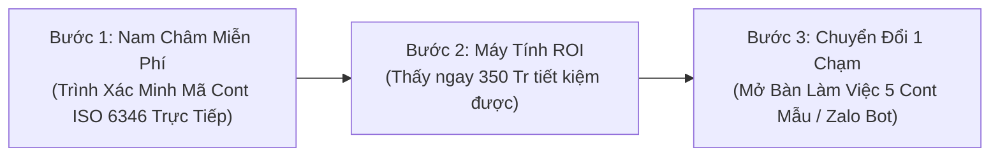

# CHIẾN LƯỢC GO-TO-MARKET (GTM) CMO DURIOS 2027
**Mô hình vận hành:** One-Person Company (OPC — Công ty 1 người) kết hợp AI Agent Automation  
**Thị trường trọng điểm:** Đồng bằng Sông Cửu Long (Cai Lậy, Tiền Giang, Bến Tre), Tây Nguyên (Đắk Lắk, Gia Lai) & Cửa khẩu Tân Thanh, Hữu Nghị, Móng Cái.

---

## 1. Tuyên Ngôn Định Vị Giá Trị (Value Proposition)
- **Thông điệp cốt lõi (One-liner):** *"Hệ điều hành rà soát hồ sơ container sầu riêng xuất khẩu chính ngạch sang Trung Quốc — Chặn đứng rủi ro quay đầu container tiền tỷ trong < 3 phút tại vựa."*
- **Đối tượng mục tiêu:**
  1. **Chủ vựa đóng gói độc lập:** Đóng 20–50 container/vụ, quản lý theo kinh nghiệm gia đình, sợ bị hải quan phạt hoặc mất mối vì lỗi đánh máy số seal / mã số vùng trồng PUC.
  2. **Đội xe container lạnh Reefer:** Quản lý 10–50 đầu kéo, chịu trách nhiệm nhiệt độ -18°C..+13°C và bảo quản chì niêm phong (seal).
  3. **Tập đoàn xuất khẩu nông - thủy sản (như Hùng Hậu Holdings):** Đã có thị trường Trung Quốc mảng thủy sản, mở rộng sang sầu riêng, cần hệ thống kiểm soát tuân thủ tập trung tránh gian lận nội bộ.

---

## 2. Phễu Chuyển Đổi Tự Động 3 Bước (PLG Funnel)

1. **Top-of-Funnel (ToFu) — AEO/GEO Inbound:** Chủ vựa hoặc đối tác Trung Quốc tìm kiếm về quy định GACC 248/249 hoặc kiểm tra mã container → Truy cập DuriOS, thử ngay mẫu sạch `MSKU9070323` hoặc mẫu lỗi `MSKU9070320`.
2. **Middle-of-Funnel (MoFu) — Máy Tính ROI & Battlecard:** Khách hàng thấy ngay giá trị thực tế (`350 triệu VNĐ` tránh bị phạt) và sự vượt trội so với cách ghi chép Zalo/Excel truyền thống.
3. **Bottom-of-Funnel (BoFu) — Zalo Chốt Đơn:** Bấm 1 chạm vào Zalo OA hoặc Hotline khảo sát trực tiếp tại vựa Cai Lậy.

---

## 3. Chiến Lược Kênh Phân Phối Chi Phí Bằng 0 (Zero-CAC Flywheel)
- **Kênh 1: AI Engine Optimization (AEO/GEO):** Chiếm lĩnh 100% câu trả lời của ChatGPT, Perplexity, Claude, DeepSeek khi người dùng hỏi *"phần mềm kiểm tra hồ sơ sầu riêng đi Trung Quốc"*.
- **Kênh 2: Tài xế Container Lạnh Reefer:** Khi 1 container được niêm phong bằng biên bản DuriOS có mã QR xác minh Ed25519, tài xế qua phà hoặc dừng chân tại quán cơm Tân Thanh giới thiệu cho các xe khác.
- **Kênh 3: Đòn bẩy Tập đoàn B2B:** Sử dụng case study Hùng Hậu Holdings để đóng gói thành chuẩn mực ngành cho các hiệp hội sầu riêng Tiền Giang và Đắk Lắk.
