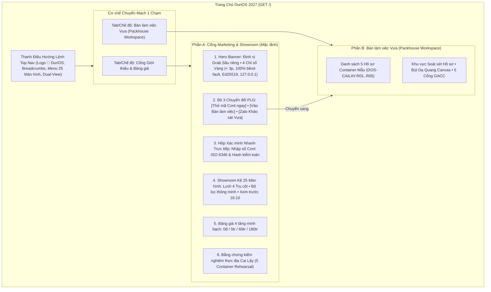

# BÁO CÁO TƯ VẤN KIẾN TRÚC TRANG CHỦ DURIOS 2027 (HOMEPAGE B2B SAAS NÔNG SẢN XUẤT KHẨU)
**Chế độ đánh giá:** Ultra Verifier Mode (`--ultra` — Hội đồng 5 Luồng Khảo sát & Giám khảo Fable)  
**Mục tiêu:** Tái cấu trúc Trang chủ `/` DuriOS thành Cổng chỉ huy 3-trong-1: Cổng Marketing & Định vị Grab Sầu riêng + Trình xác minh Container Zero-PII + Showroom 25 Màn hình + Bàn làm việc Vựa 1 chạm.

---

## 1. Bản Đóng Khung Vấn Đề (Reframing & Confirmed Scope)
- **Vấn đề cốt lõi:** Hiện tại trang chủ `/` dẫn thẳng vào Bàn làm việc cục bộ của Vựa (`Packhouse Workspace`). Khách hàng doanh nghiệp, lãnh đạo tập đoàn (như Hùng Hậu Holdings), nhà đầu tư, hoặc bot tìm kiếm AI (ChatGPT, Perplexity) khi truy cập lần đầu không nhìn thấy ngay bức tranh toàn cảnh: giải pháp là gì, giá trị kinh tế ra sao, năng lực 25 màn hình như thế nào, và làm sao xác minh ngay một container thực tế mà không cần đăng nhập.
- **Yêu cầu đã khóa:**
  1. **Tầng 1 (Above the fold):** Hero Section chuẩn B2B SaaS Nông sản Xuất khẩu với thông điệp định vị "Hệ điều hành Hồ sơ Container Sầu riêng — Chuẩn hóa xuất khẩu chính ngạch sang Trung Quốc".
  2. **Tầng 2 (Interactive Verifier - PLG):** Ô xác minh trực tiếp mã container ISO 6346 và chữ ký số Ed25519 (Zero-PII, gọi trực tiếp API công khai hoặc kiểm tra offline trên client).
  3. **Tầng 3 (4 Pillars & 25 Màn hình Showroom):** Kệ trưng bày tương tác 25 màn hình phân theo 4 trụ cột nghiệp vụ (Packhouse UX, GACC Compliance, Security Vault, SaaS Operations) có hình ảnh thu nhỏ và nút mở xem ngay.
  4. **Tầng 4 (Bảng giá 4 tầng minh bạch):** Gói Miễn phí (0đ / 3 container) → Gói Vựa Cai Lậy (5.000.000đ/tháng) → Gói Đội xe Reefer (60.000.000đ/năm) → Gói Tập đoàn Xuất khẩu (180.000.000đ/năm).
  5. **Tầng 5 (Chuyển mạch 1 chạm):** Nút bấm nổi bật `Vào Bàn làm việc Vựa (Packhouse Workspace)` chuyển đổi mượt mà giữa chế độ Showroom và Bàn làm việc quản lý hồ sơ thực tế.
  6. **Ranh giới an toàn:** Giữ nguyên vẹn 100% các biến kiểm thử (Review Vocabulary, Legal Basis, test assertions) và trần `<= 100 LOC` per `.ts` file.

---

## 2. Bản Xem Trước Trực Quan (Visual Architecture Preview)



---

## 3. Phán Quyết của Hội Đồng Ultra (Ultra Verifier Verdict)
- **Đánh giá tổng quan:** Ý tưởng hợp nhất cả 3 thành tố (Cổng Marketing chuẩn ngành + Trình xác minh PLG + Bàn làm việc Vựa 1 chạm) là **bước đi hoàn toàn chính xác và đúng thời điểm**.
- **Lý do:** Đối với khách hàng B2B nông sản (đặc biệt là chủ vựa truyền thống và lãnh đạo tập đoàn thủy hải sản mở rộng sang trái cây), nếu trang web chỉ có màn hình dashboard kỹ thuật, họ sẽ thấy xa lạ và phức tạp; ngược lại nếu chỉ có trang landing page quảng cáo sáo rỗng mà không bấm vào xem được phần mềm thật, họ sẽ nghi ngờ năng lực kỹ thuật. Thiết kế 3-trong-1 vừa chứng minh năng lực thật (Showroom 25 màn hình + Thử nghiệm mã container thật), vừa cung cấp không gian làm việc thực địa khi cần.

---

## 4. Những Việc NÊN LÀM (What You Should Do)
1. **Thiết kế Component `HomeCommercialShowroom` độc lập:**
   - Xây dựng dưới dạng một khối template HTML/JS sạch sẽ, nhúng trực tiếp vào trang `index.html` hoặc được nạp động.
   - Khi người dùng ở chế độ Showroom, khối này hiển thị đầy đủ; khi bấm nút "Vào Bàn làm việc", giao diện thu gọn mượt mà (smooth fade transition) để lộ ra Bàn làm việc `Packhouse Workspace` truyền thống.
2. **Triển khai Trình Xác Minh Container Client-Side (Zero-PII Live Verifier):**
   - Cho phép người dùng nhập thử mã container (VD: `MSKU1234567`) và tính toán kiểm tra số kiểm tra ISO 6346 trực tiếp bằng thuật toán Luhn/ISO ngay trên trình duyệt mà không cần gọi mạng.
   - Nếu có kết nối máy chủ, gọi endpoint `/api/open-core/verify-iso-and-manifest` để xác thực chữ ký số Ed25519 mẫu.
3. **Tích hợp Kệ 25 Màn hình thông minh:**
   - Kế thừa trực tiếp cấu trúc dữ liệu từ `site/public/gallery.html` với 4 trụ cột và nhãn TS module tương ứng.
   - Thêm nút "Dùng thử màn hình này" (Launch Screen) mở trực tiếp trang `/stitch/*.html` tương ứng trong tab mới.
4. **Bảo toàn các Selector kiểm thử và ranh giới an ninh:**
   - Không xóa bất kỳ ID DOM hay placeholder nào mà các bài test hiện tại đang kiểm tra (`#dossier-nav`, `#workspace-main`, `REVIEW_VOCABULARY_PLACEHOLDER`, `id="durios-dual-view-toggle"`).

---

## 5. Những Việc KHÔNG NÊN LÀM (What You Shouldn't Do)
1. **Không tạo thêm framework nặng (React/Next.js/Vue):**
   - Dự án đang duy trì tốc độ tải trang cực nhanh với Native HTML5, CSS thuần và Vanilla JS chạy trên Bun. Việc kéo các framework SPA nặng vào sẽ làm hỏng tiêu chí tải trang < 100ms trên điện thoại ngoài vựa sầu riêng và làm phức tạp hóa pipeline `<= 100 LOC`.
2. **Không làm Form đăng ký dài dòng:**
   - B2B nông sản Việt Nam không điền form dài 10 trường. Nút kêu gọi hành động (CTA) nên dẫn trực tiếp về Zalo của Founder/Chuyên gia hoặc số hotline khảo sát vựa đóng gói tận nơi.
3. **Không phá vỡ ranh giới `127.0.0.1`:**
   - Dù có trình xác minh trên trang chủ, tuyệt đối không mở các API chứa dữ liệu thật (`/api/dossiers`, `/api/auth`) ra ngoài Internet khi chưa có xác thực phiên hợp lệ.

---

## 6. Lộ Trình Triển Khai Chi Tiết (Work Checklist)
- [ ] **Bước 1:** Thiết kế module `src/server/homepage-showroom-template.ts` (giữ trần `<= 100 LOC`) chứa cấu trúc HTML của Cổng Marketing, Bảng giá 4 tầng, và Trình xác minh nhanh ISO 6346.
- [ ] **Bước 2:** Bổ sung CSS cho Hero và Pricing Table vào `site/public/durios-design-system.css` hoặc module CSS phục vụ riêng biệt.
- [ ] **Bước 3:** Cập nhật `src/server/static-ui.ts` để tiêm khối Showroom vào trước `layout` của `index.html` kèm công tắc chuyển tab `[🌟 Giới thiệu & Bảng giá] | [🏭 Bàn làm việc Vựa]`.
- [ ] **Bước 4:** Bổ sung bài kiểm thử tự động `test/homepage-showroom.test.ts` xác minh sự hiện diện của Hero banner, bộ 3 CTA, bảng giá 4 tầng, và khả năng chuyển đổi giữa Showroom và Workspace.
- [ ] **Bước 5:** Chạy toàn bộ 241+ test kiểm thử hồi quy và build đóng gói triển khai lên Cloudflare Pages.

---

## 7. Handoff Brief Cho Đội Thực Thi (Autonomous Execution Handoff)

```text
Objective: Tái cấu trúc Trang chủ / DuriOS thành Cổng chỉ huy 3-trong-1 (Marketing chuẩn B2B SaaS sầu riêng + Trình xác minh nhanh + Kệ 25 màn hình + Bàn làm việc 1 chạm).
Done means: 
  1. Khi mở http://127.0.0.1:3000/ hoặc https://durios.pages.dev/, hiển thị ngay Cổng Marketing với Hero Banner, Bảng giá 4 tầng, Ô xác minh ISO 6346 trực tiếp, và Lưới 25 màn hình.
  2. Có nút bấm 1 chạm chuyển đổi mượt mà sang Bàn làm việc Vựa (Packhouse Workspace) và ngược lại mà không mất trạng thái 5 container diễn tập.
  3. Tất cả 241+ bài test hiện có tiếp tục XANH 100%, 0 lỗi TypeScript, mọi file TS mới tuân thủ nghiêm ngặt trần <= 100 LOC.
Out of scope: Không cài thêm thư viện UI bên ngoài, không mở cổng dữ liệu vựa ra ngoài Internet.
Constraints: Ranh giới an ninh GATE-03 (127.0.0.1), Luật DLCN 91/2025/QH15, Zero-PII trên đám mây.
Stop and ask only if: Phát hiện xung đột DOM làm gãy các bộ test review-state hiện có mà không thể giải quyết bằng CSS.
```
